> **[📖 查看完整更新日志（含 fork 版本与上游版本历史）→](./changelog.md)**

# koishi-plugin-music-link-vincentzyu-fork

[](https://www.npmjs.com/package/koishi-plugin-music-link-vincentzyu-fork)
[](https://www.npmjs.com/package/koishi-plugin-music-link-vincentzyu-fork)
[](https://github.com/VincentZyuApps/koishi-plugin-music-link-vincentzyu-fork)
[](https://gitee.com/vincent-zyu/koishi-plugin-music-link-vincentzyu-fork)
[](https://forum.koishi.xyz/t/topic/12120)
[](https://qm.qq.com/q/4vjto4V7Di)

💬 插件使用问题 / 🐛 Bug 反馈 / 👨‍💻 交流讨论：欢迎加入新 QQ 群：**1085190201** 🎉  
*(注：原交流群 259248174 已失效。在群内艾特作者 `@VincentZyu` 可获得更快速的回复)*

---

## ✨ 核心特性

- 🔍 **多平台聚合搜索**：基于落月 API 深度定制，支持网易云音乐、QQ 音乐、酷狗音乐并行并发搜索并交替聚合排序；亦保留网易云独立专线。
- ⚡ **多引擎歌单渲染**：
  - 🚀 **Canvas (Skia)**：基于 `@napi-rs/canvas` 与 Skia 原生驱动，轻量高效、出图极快，无需浏览器环境。
  - 🦀 **resvg (Rust)**：Rust 编写的高性能 SVG 渲染器，零外部依赖，极低内存与 CPU 占用，矢量清晰锐利。
  - 🎭 **Puppeteer**：传统浏览器排版引擎，支持毛玻璃拟物化特效、自定义字体与精细 CSS 样式。
  - 💬 **QQ Markdown**：专为 QQ 官方 Bot 优化的原生 Markdown 表格与列表输出，零图片流量开销。
- 🐧 **QQ 官 Bot 全链路适配**：深度支持原生图文大卡片、RichUI 音乐卡片、高清封面、语音与群文件直发。
- 🎧 **无损音质与多格式直链**：支持从标准音质直至网易云超清母带 (Master)、QQ 音乐臻品母带 2.0、酷狗 Hi-Res / SQ 无损等高规格音频。
- 🛡️ **高可靠与资源自愈**：启动时自动拉取歌单背景与字体文件，内置 Gitee / GitHub 双镜像容灾与 SHA-256 哈希校验。

---

## 🖼️ 效果图鉴

### 🐧 QQ 官 Bot 专属链路展示

> 📤 **QQ 平台原生图文卡片 / 语音 / 媒体与文件发送链路** - 展示官 QQ Bot 平台下的歌曲列表图片、音频与文件发送链路效果

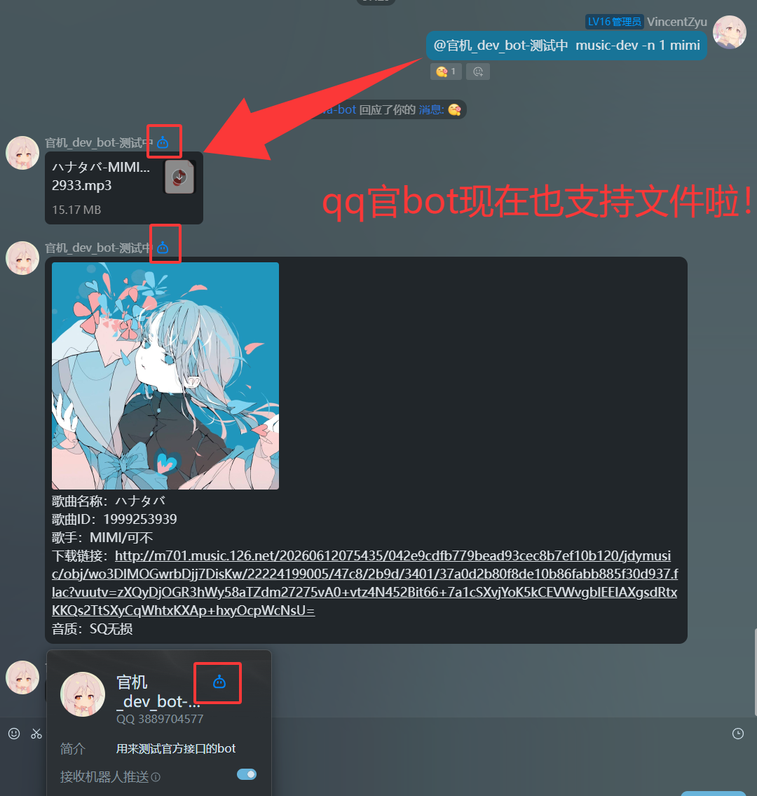

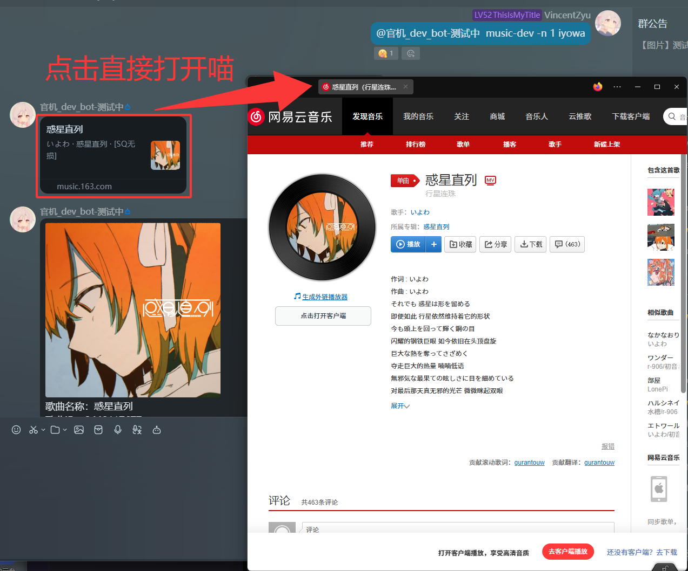

---

### 🎨 多引擎歌单渲染风格

#### 1. ⚡ Canvas 渲染模式 (`v1.9.11+`)
> 基于 `@napi-rs/canvas` / Skia 的轻量高速渲染方案。无需浏览器进程，内存占用极低，支持 `canvasScale` 高清缩放与自定义字体。

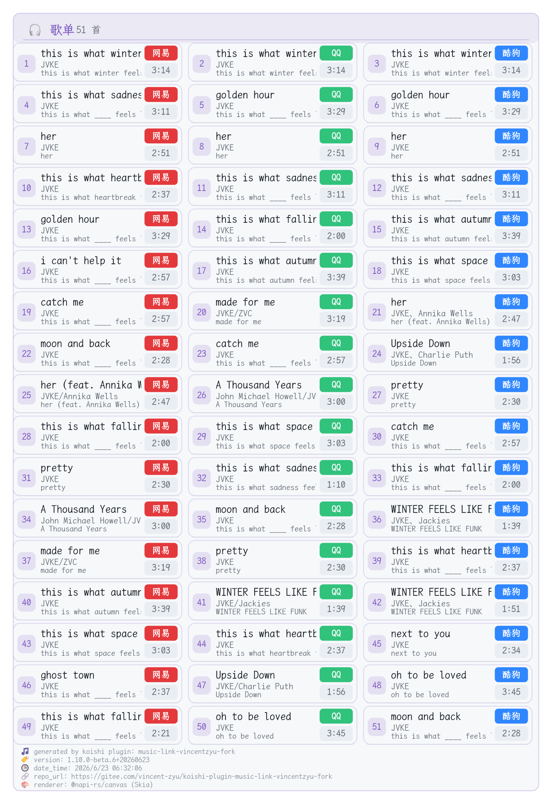

#### 2. 🦀 resvg 渲染模式 (`v1.9.0+`)
> 基于 Rust 编写的高性能 SVG 渲染器。内存安全，开箱即用，高 DPI 渲染细腻无锯齿。

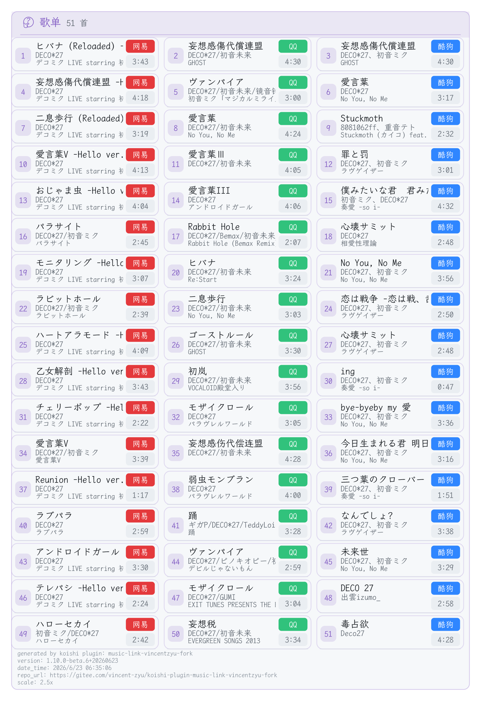

#### 3. 🎭 Puppeteer 渲染模式（传统模式）
> 基于无头浏览器的传统渲染方式，支持高度定制化的样式与特效（如毛玻璃背景、圆角阴影等）。  
> *⚠️ 注意：Puppeteer 模式内存占用相对较高，建议内存充裕的服务器选用，并推荐[配置 Swap 分区](https://vincentzyu233.github.io/VincentZyu233/notes/system-config/swap.html)防止 OOM。*


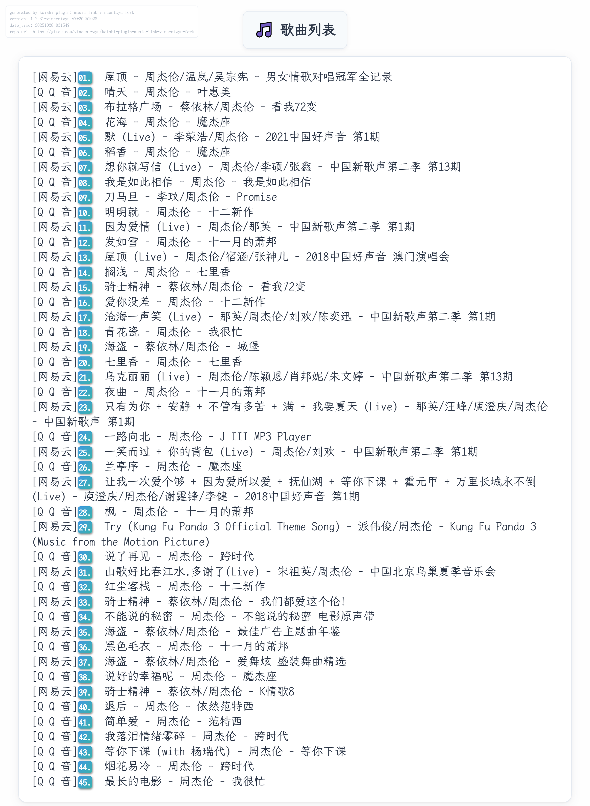
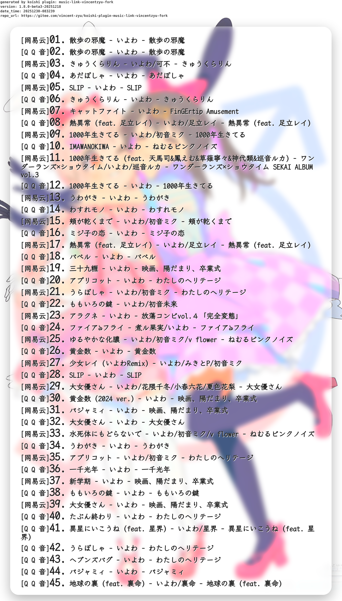

#### 4. 💬 QQ 原生 Markdown 渲染模式 (`v1.9.6+`)
> 专为 QQ 官方机器人适配的 Markdown 排版，支持表格风格与列表风格，交互友好。

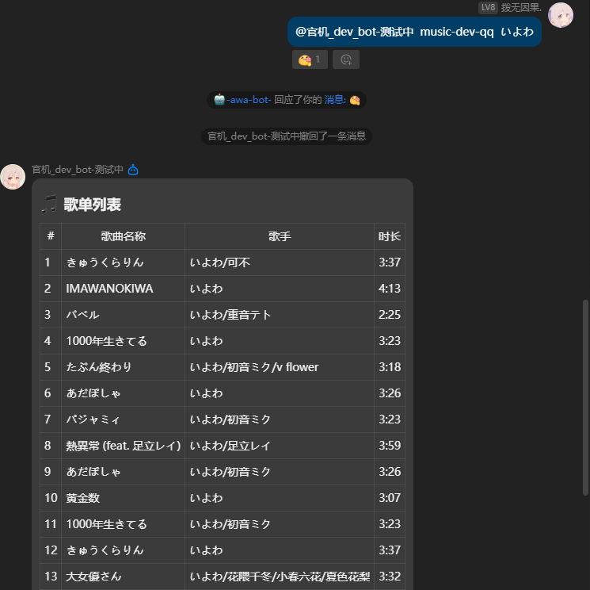
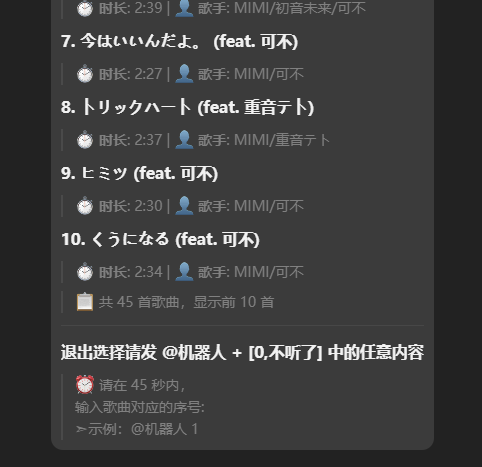

---

### 🌐 跨平台与扩展协议端预览

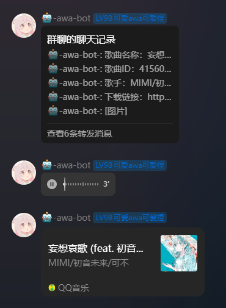
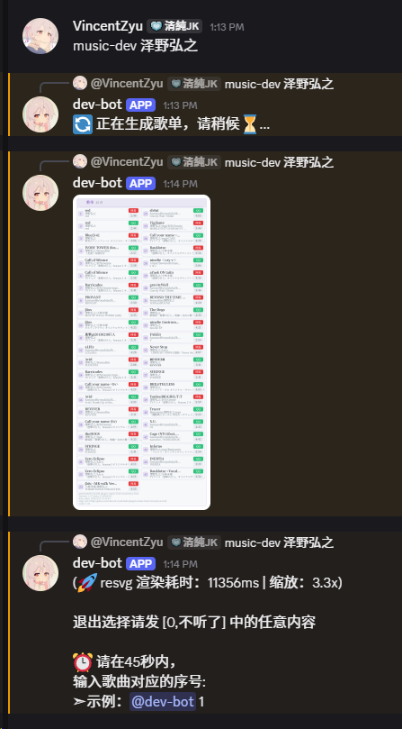

---

## 📦 安装与配置

### 1. 安装插件

- **Koishi 插件市场**：在市场中搜索 `music-link-vincentzyu-fork` 并点击安装。
- **Koishi 依赖管理**：在依赖管理页面点击右上角 `+`，输入并添加 `koishi-plugin-music-link-vincentzyu-fork`。
- **命令行安装**：
  ```bash
  # 使用 Yarn
  yarn add koishi-plugin-music-link-vincentzyu-fork
  
  # 使用 NPM
  npm install koishi-plugin-music-link-vincentzyu-fork
  ```

### 2. 首次启动与资源准备

插件首次启动时，会自动从 Gitee Release（失败则自动回退至 GitHub Release）下载所需的字体和背景图片，并在下载完成后校验 SHA-256。**资源文件就绪后才会正式注册指令与中间件。**

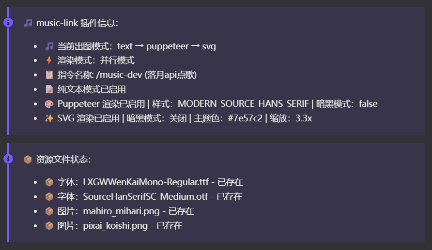

#### 📥 离线 / 手动下载指南
若服务器处于内网或下载受阻，可手动下载下列文件并放置于指定目录：

- **目标目录**：`Koishi 根目录/data/assets/music-link-vincentzyu-fork/`
- **字体文件**：
  - [LXGWWenKaiMono-Regular.ttf](https://gitee.com/vincent-zyu/koishi-plugin-music-link-vincentzyu-fork/releases/download/assets/LXGWWenKaiMono-Regular.ttf)
  - [SourceHanSerifSC-Medium.otf](https://gitee.com/vincent-zyu/koishi-plugin-music-link-vincentzyu-fork/releases/download/assets/SourceHanSerifSC-Medium.otf)
- **背景图片**：
  - [mahiro_mihari.png](https://gitee.com/vincent-zyu/koishi-plugin-music-link-vincentzyu-fork/releases/download/assets/mahiro_mihari.png)
  - [pixai_koishi.png](https://gitee.com/vincent-zyu/koishi-plugin-music-link-vincentzyu-fork/releases/download/assets/pixai_koishi.png)

放置完成后重启插件即可通过校验并正常启动。

---

## 📖 指令与使用指南

> 💡 提示：所有指令名称均可在插件配置项中自定义，下列指令名以默认值为准。

### 🎶 1. 落月点歌 (`command9` - 推荐)

支持多平台聚合检索的高级搜索指令：
```text
落月点歌 [歌曲名称]
落月点歌 -n 1 [歌曲名称]
```
> 📌 参数 `-n <序号>`：直接获取指定排名的歌曲详情并执行发送，跳过选歌中间态。

#### 聚合搜索分配逻辑
- 配置项 `command9_platforms` 支持多选 `netease`（网易云）、`tencent`（QQ音乐）、`kugou`（酷狗）。
- 当勾选多个平台时，插件将并发请求各平台并交替合并结果。
- 设目标总量配置为 $Len$（`command9_searchListLength`），已选平台数为 $n$，则单平台单次拉取量 $m$ 为：
  $$m = \left\lceil \frac{Len}{n} \right\rceil$$
  *示例：设置 $Len = 50$，$n = 3$ 时，每个平台请求 $\lceil 50/3 \rceil = 17$ 首，最终交替合并出最多 $17 \times 3 = 51$ 首候选歌曲。*

#### 落月 API 音质档位对照表

| 🎵 平台 | 🎛️ 音质档位 | 📊 对应码率 / 编码格式 |
| :--- | :--- | :--- |
| **网易云** | 标准 | 64k / 128k |
| **网易云** | HQ 极高 | 192k / 320k |
| **网易云** | SQ 无损 | FLAC |
| **网易云** | Hi-Res | 高解析度无损 |
| **网易云** | Spatial Audio | 高清臻音 |
| **网易云** | Master | 超清母带 |
| **QQ 音乐** | 标准 / HQ | 标准 / 320k 高音质 |
| **QQ 音乐** | SQ 无损 | FLAC 无损音质 |
| **QQ 音乐** | Hi-Res | Hi-Res 音质 |
| **QQ 音乐** | 杜比全景声 | Dolby Atmos |
| **QQ 音乐** | 臻品母带 2.0 | Master 2.0 |
| **酷狗音乐** | 标准音质 | 128 kbps (`128`) |
| **酷狗音乐** | HQ 高品质 | 320 kbps (`320`) |
| **酷狗音乐** | SQ 无损 | FLAC (`flac`) |
| **酷狗音乐** | Hi-Res | high (`high`) |

> ⚠️ 酷狗音乐模式或多平台聚合模式下，建议使用“先搜索后选歌”流程；歌曲 ID 直点目前主要适配网易云与 QQ 音乐。

---

### 🎵 2. 网易点歌 (`command6` - 网易云专线)

专用于网易云音乐检索与直搜的经典指令：
```text
网易点歌 [歌曲名称 / 歌曲ID]
```

---

### 🎯 3. 消息发送类型配置

在插件配置面板的对应指令中，可灵活修改 `返回字段表` 内 `下载链接` 对应的 `字段发送类型`：

| 发送类型 | 发送效果 | 运行依赖与平台说明 |
| :--- | :--- | :--- |
| `text` | 返回文本消息与下载超链接 | 通用，无特殊环境依赖 |
| `audio` | 转换为语音消息发送 | 需要环境中配置 `silk`、`ffmpeg` 等媒体服务 |
| `video` | 转换为短视频消息发送 | 需要对应平台及协议端支持 |
| `file` | 作为群文件直接上传发送 | 实测支持 OneBot 及 QQ 官 Bot（需平台协议端开通文件能力） |

---

## 🌐 后端 API 服务说明

### 1. 落月 API 后端

| 接口端点 | 网易云 | QQ 音乐 | 酷狗音乐 | 说明 |
| :--- | :---: | :---: | :---: | :--- |
| `https://api.vkeys.cn/v2` | ✅ 支持 | ✅ 支持 | ❌ 暂不支持 | 落月 API 官方原生接口 |
| `https://luoyue-api-cf.vincentzyu233.cn` | ✅ 支持 | ✅ 支持 | ✅ 支持 | **维护者自建 CDN 超集端点**，增加了酷狗 API 扩展，兼容官方全部能力 |

> 💡 若自建接口遇到临时波动，可前往交流 QQ 群 `1085190201` 联系 `@VincentZyu` 反馈。

### 2. 网易云第三方 API 候选列表 (command6)

| 端点地址 | 特性与稳定性 | VIP 权限策略 | 推荐等级 |
| :--- | :--- | :--- | :--- |
| `api.injahow.cn` | 响应迅速稳定，免 Puppeteer 服务，官 Bot 首选 | ⚠️ VIP 歌曲限制试听 45s | 🌟 默认推荐 |
| `api.qijieya.cn` | 完整版支持，稳定性视公共节点而定 | ✅ 无 VIP 限制，支持完整播放 | 👍 推荐 |
| `meting.jmstrand.cn` | Meting 兼容公共节点 | ✅ 全部支持完整收听 | ⚪ 可选备用 |
| `metingapi.nanorocky.top` | 提供高品质无损音频，体积大下载稍慢 | ✅ 支持完整收听 | ⚠️ 不推荐（大文件） |

---

## ⚖️ 免责声明与项目渊源

### 📜 项目渊源
- 本项目 Fork 自上游原始项目 `koishi-plugin-music-link`（上游 Fork 基准版本为 `1.7.30`，原作者 `shangxueink`）。
- 因原作者停止维护并下线仓库，本项目现由 **VincentZyu Apps** 团队作为独立主干持续维护，后续引入了多引擎渲染（Canvas/resvg）、QQ 官 Bot 图文链路、酷狗聚合与自建 CDN 容灾等功能。非常感谢原作者最初的架构奠基！

### 🛡️ 免责声明
1. **数据来源**：本插件调用的所有接口均来自第三方公共或公开 API 服务，开发者不对第三方服务的内容、合法性或可用性承担保证责任。
2. **版权归属**：检索返回的所有音频、图片、文字及元数据版权均归原作者或对应音乐发行版权方所有。本插件仅供个人技术研究与学习交流，禁止用于任何商业营利行为。
3. **合规使用**：使用者应严格遵守所在地区的法律法规及对应平台规范，尊重知识产权。因不当使用产生的纠纷均由使用者自行承担。

---

## 📋 更新日志

详细的版本变更记录与升级指南，请参阅：  
👉 **[完整更新日志（CHANGELOG.md）](./changelog.md)**
